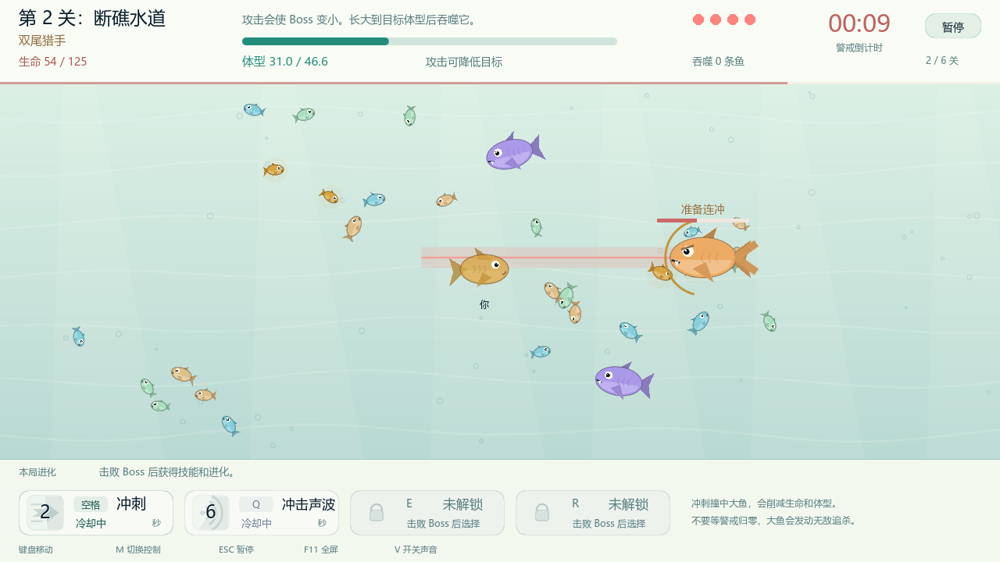

# 潮汐进化 · Tidebound

这是 Tian 的第一个上手游戏 Demo。当前版本为 **0.8**，完成于 **2026-10-10**。

在六片海域里吃小鱼成长，使用冲刺与逐关解锁的技能对抗 Boss，再选择进化继续下一关。这个项目用于练习玩法设计、试玩反馈、数值验证和打包发布。

## 试玩

Windows 用户到本仓库 Releases 下载 `Tidebound-0.8-Windows-x64.zip`，完整解压后运行 `Tidebound.exe`。`Tidebound.pck` 必须留在同一目录，无需安装 Godot。

鼠标或 WASD 移动，空格冲刺；Q / E / R 使用当前技能栏。ESC 暂停，F11 全屏，M 切换控制方式，V 开关声音。

## 内容

- 六个关卡，包含连冲、电弹、陷阱、吸水、三轮扫射和旋转针刺。
- 旋涡、声波、护泡、撕咬、墨幕五种主动技能，最多装备三种。
- 随机进化选择与跨关能力累积。
- 固定种子自动模拟，用真实游戏逻辑检查成长叠加和逐关时间余量。



## 开发与运行

使用 **Godot 4.7.2** 打开 `game/project.godot`，运行主场景。主要逻辑位于 `game/main.gd`。

```sh
godot --path game
godot --headless --path game -- --self-test
godot --headless --path game -- --balance-test
godot --headless --path game -- --simulate --samples=20 --seed-start=9000 --report=balance-v8-final
```

在源码根目录先创建 `work/`，用于保存模拟输出。自动模拟只给候选路线的数据，不等同于真人试玩，也不声称找到数学意义上的全局最优路线。

## 当前状态

这是已完成首版、可以试玩的学习 Demo。暂时没有存档、局外成长或 Steam 发布。后续方向待定。

通过持续试玩反馈，迭代玩法、数值和操作体验。

模拟报告见 [0.8 自动平衡验证](docs/0.8模拟报告.md)。Godot 引擎相关许可见仓库中的 `LICENSE-GODOT.txt` 与 `COPYRIGHT-GODOT.txt`。
